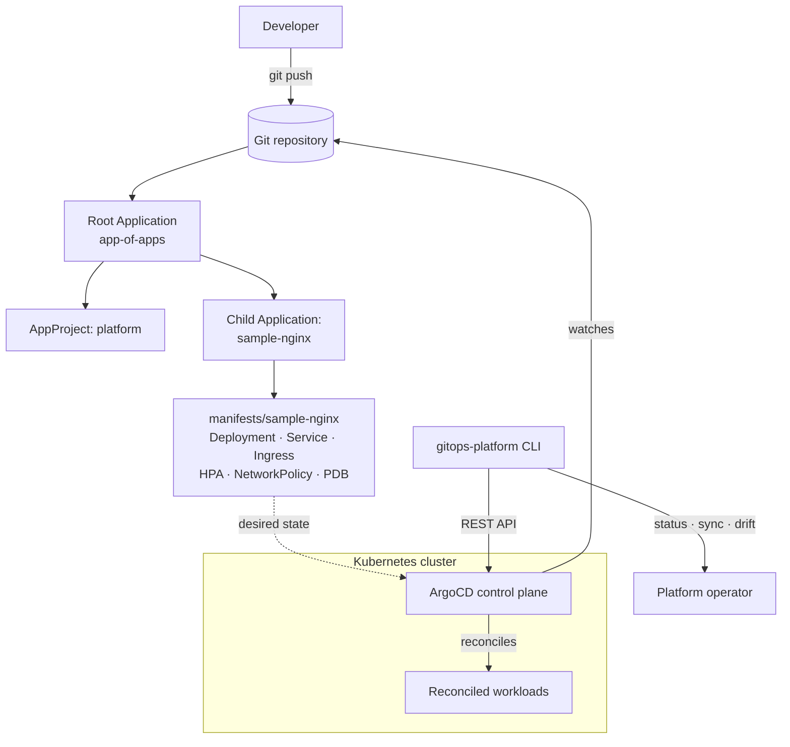

# ArgoCD GitOps Platform

> Declarative, git-driven Kubernetes delivery built on ArgoCD — an app-of-apps
> layout, production-grade manifests, and a Python control helper for sync,
> status, and configuration-drift detection.

[](LICENSE)
[](https://github.com/abhisheksawant52/argocd-gitops-platform/actions/workflows/ci.yml)
[](https://www.python.org)
[](https://argo-cd.readthedocs.io)
[](https://kubernetes.io)

## Overview

The ArgoCD GitOps Platform turns a Git repository into the single source of truth
for Kubernetes application delivery. Desired state lives in version control;
ArgoCD continuously reconciles the cluster to match it, and reverts unauthorized
manual changes via self-heal.

The repository is organised around the ArgoCD **app-of-apps** pattern. A single
root Application bootstraps an `AppProject` and a set of child Applications, each
of which points at a workload directory of plain Kubernetes manifests. Adding a
new service is as simple as committing a new child Application and its manifests —
no imperative `kubectl apply` required.

Alongside the declarative assets ships `gitops-platform`, a small Python CLI that
wraps the ArgoCD REST API. Platform operators use it to inspect sync/health
status, trigger syncs, and produce a drift report suitable for CI gates or
scheduled auditing. It is intended for cluster operators and platform teams who
want a repeatable, auditable, review-driven deployment workflow.

## Architecture



Components:

- **Root Application** (`argocd/root-app.yaml`) — app-of-apps entrypoint that
  renders every child Application under `argocd/applications/`.
- **AppProject** (`argocd/projects/platform.yaml`) — restricts which repos,
  clusters, and namespaces the platform may deploy to.
- **Child Applications** (`argocd/applications/`) — one Application per workload.
- **Workload manifests** (`manifests/<app>/`) — the actual Kubernetes objects.
- **Control-plane install** (`clusters/argocd/`, `terraform/`) — install ArgoCD
  via manifests or the official Helm chart.
- **Control helper** (`src/gitops_platform/`) — the `gitops-platform` CLI.

## Features

- App-of-apps bootstrap: one Application to manage all others.
- Scoped `AppProject` with source-repo, destination, and orphaned-resource guards.
- Automated sync with prune, self-heal, and exponential-backoff retry.
- Hardened sample workload: non-root, read-only rootfs, dropped capabilities,
  HPA, PodDisruptionBudget, and a default-deny-ish NetworkPolicy.
- `gitops-platform` CLI: `status`, `sync`, and `drift` commands over the ArgoCD API.
- Configuration drift detection with severity classification (usable as a CI gate).
- Terraform module to install ArgoCD via Helm.
- Multi-stage, non-root container image with a healthcheck.
- Full CI: lint, multi-version tests, manifest validation, and a Docker build.

## Tech Stack

| Layer | Technology |
|-------|------------|
| GitOps engine | ArgoCD (Application, AppProject CRDs) |
| Orchestration | Kubernetes 1.29+ |
| Control helper | Python 3.11+, Click, Requests, Pydantic Settings |
| Provisioning | Terraform, Helm (argo-cd chart) |
| Container | Docker (multi-stage, distroless-style slim runtime) |
| CI | GitHub Actions |
| Quality | ruff, black, pytest, pre-commit |

## Getting Started

### Prerequisites

| Tool | Version | Install |
|------|---------|---------|
| kubectl | 1.29+ | <https://kubernetes.io/docs/tasks/tools/> |
| ArgoCD CLI | latest | <https://argo-cd.readthedocs.io/en/stable/cli_installation/> |
| Terraform | 1.5+ | <https://developer.hashicorp.com/terraform/install> |
| Python | 3.11+ | <https://www.python.org> |
| Helm | 3.x | <https://helm.sh/docs/intro/install/> |

### 1. Install the ArgoCD control plane

```bash
kubectl create namespace argocd
kubectl apply -n argocd \
  -f https://raw.githubusercontent.com/argoproj/argo-cd/stable/manifests/install.yaml

# Apply namespace labels and the LoadBalancer service.
kubectl apply -f clusters/argocd/install.yaml

# Retrieve the initial admin password.
kubectl -n argocd get secret argocd-initial-admin-secret \
  -o jsonpath='{.data.password}' | base64 -d
```

Alternatively, install ArgoCD with Terraform:

```bash
cd terraform
cp terraform.tfvars.example terraform.tfvars   # then edit
terraform init
terraform apply
```

### 2. Bootstrap the platform (app-of-apps)

```bash
kubectl apply -f argocd/projects/platform.yaml
kubectl apply -f argocd/root-app.yaml
```

ArgoCD now renders the child Applications under `argocd/applications/` and syncs
`manifests/sample-nginx/` into the `sample-app` namespace automatically.

### 3. Install and use the control helper

```bash
make install                      # editable install with dev extras
cp .env.example .env              # then fill in ARGOCD_* values

gitops-platform status            # list apps + sync/health
gitops-platform sync --app sample-nginx --prune
gitops-platform drift --project platform
```

## Project Structure

```text
argocd-gitops-platform/
├── argocd/
│   ├── projects/platform.yaml        # AppProject
│   ├── applications/sample-nginx.yaml # Child Application
│   └── root-app.yaml                 # App-of-apps root
├── manifests/
│   └── sample-nginx/                 # Deployment, Service, Ingress, HPA,
│                                     #   NetworkPolicy, PDB, ServiceAccount
├── clusters/
│   └── argocd/install.yaml           # Namespace + LoadBalancer service
├── terraform/                        # Install ArgoCD via Helm
├── src/gitops_platform/              # Python control helper
│   ├── main.py                       # Click CLI (status/sync/drift)
│   ├── config.py                     # pydantic-settings
│   ├── logging_config.py
│   ├── argocd_client.py              # ArgoCD REST API wrapper
│   ├── sync.py                       # Sync orchestration
│   └── drift.py                      # Drift detection
├── tests/                            # pytest suite
├── docs/architecture.md
├── .github/workflows/                # ci.yml, gitops-sync.yml
├── Dockerfile
└── pyproject.toml
```

## Configuration

Runtime configuration is read from the environment (and an optional `.env`).
See [`.env.example`](.env.example).

| Variable | Default | Description |
|----------|---------|-------------|
| `ARGOCD_SERVER` | `localhost:8080` | ArgoCD API host:port (no scheme). |
| `ARGOCD_AUTH_TOKEN` | _(empty)_ | Bearer token from `argocd account generate-token`. |
| `ARGOCD_INSECURE` | `true` | Skip TLS verification (set `false` in production). |
| `ARGOCD_TIMEOUT` | `30` | Per-request timeout in seconds. |
| `GITOPS_DEFAULT_PROJECT` | `platform` | Default AppProject for the helper. |
| `GITOPS_SYNC_TIMEOUT` | `300` | Seconds to wait for an app to be healthy. |
| `GITOPS_LOG_LEVEL` | `INFO` | Log level. |

## Deployment

- **Kubernetes / ArgoCD**: apply the AppProject and root Application (see Getting
  Started). Child Applications and workload manifests live in `argocd/` and
  `manifests/`.
- **Terraform**: `terraform/` installs the ArgoCD control plane via the official
  `argo-cd` Helm chart. Copy `terraform.tfvars.example` and adjust before apply.
- **Container**: build the control helper image with `make docker`
  (`ghcr.io/abhisheksawant52/argocd-gitops-platform`).
- **CI**: `.github/workflows/ci.yml` runs lint, tests, manifest validation, and a
  Docker build. `.github/workflows/gitops-sync.yml` validates manifests on PRs and
  can trigger an ArgoCD sync on merge to `main`.

## Contributing

Contributions are welcome. Please read [CONTRIBUTING.md](CONTRIBUTING.md) and the
[Code of Conduct](CODE_OF_CONDUCT.md) before opening a pull request.

## Security

Please report vulnerabilities as described in [SECURITY.md](SECURITY.md). Do not
open public issues for security reports.

## License

Released under the [MIT License](LICENSE).
